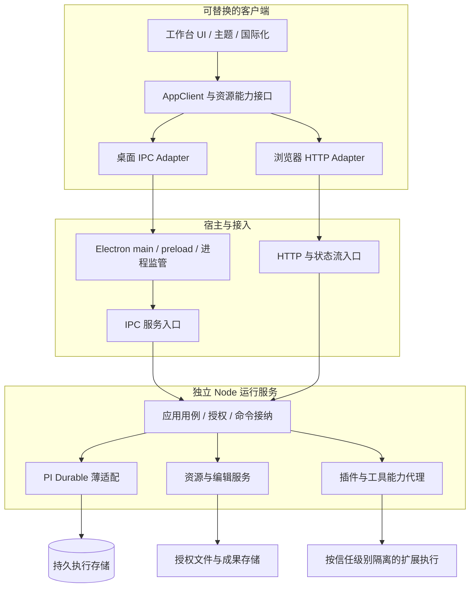

# Hipi Work 工程蓝图

日期：2026-10-19。状态：设计提案，可进入评审；不是已实现架构或生产验收报告。

## 1. 产品承诺如何变成系统约束

用户应能把真实工作交给 Agent，并在一个工作台里理解过程、介入决策、检查成果、继续被打断的工作。系统不靠一个复杂的聊天组件实现这一点，而由四个明确的模型协作：

1. **工作模型**：工作区、会话、提交与执行任务，回答“这是谁的工作，现在进行到哪里”。
2. **资源模型**：文件、版本、编辑缓冲区与成果，回答“改了什么，能否安全保存”。
3. **能力模型**：工具、插件、授权与执行环境，回答“允许做什么，谁负责约束”。
4. **呈现模型**：可重建的读取投影、主题、语言和视图状态，回答“如何清楚、流畅地展示”。

架构的价值不是层数，而是一个错误不会悄悄变成另一个层面的错误。例如 UI 断线不应变成任务取消；保存冲突不应变成用户修改丢失；工具超时不应变成操作从未发生。

## 2. 六条不可破坏的约束

| 编号 | 约束 | 对应的可观察结果 |
| --- | --- | --- |
| I1 | 执行事实只有一个权威，UI 是投影 | 重载窗口后状态从服务恢复，不从前端缓存反写任务状态 |
| I2 | 接纳命令与完成命令是不同事件 | 丢失回复后可查询已有提交，不重复启动同一工作 |
| I3 | 外部副作用可能处于结果未知 | 断线或取消后，已发生的文件修改、消息发送不会被界面假装撤销 |
| I4 | 内容有身份和版本，编辑是独立会话 | 用户与 Agent 同时修改文件时能发现冲突，不静默覆盖 |
| I5 | 权限由可信服务执行，不由界面决定 | 换成 HTTP 客户端、禁用按钮或插件调用都不能绕过授权 |
| I6 | 所有持续增长都有预算和结束条件 | 慢消费者、长会话、日志和预览不会依赖无限内存维持运行 |

这些约束需要契约测试、故障注入与真实平台证据。文档中的“必须”不代表当前已有对应实现。

## 3. 核心结构

图中的模块不是微服务，也不要求每个方框成为一个 npm 包。第一版在一个仓库、一个桌面应用中部署；只有 UI、执行和必要的扩展边界需要进程隔离。主进程不运行 Agent 调度，也不承担第二套数据写入逻辑。

UI 和核心服务不得引用 Electron；桌面组装入口才连接 preload 与平台适配器。HTTP 组装入口可以在独立 Node 进程运行相同用例。公开 API 不暴露 Chord 对象句柄、事务回调或任意数据库访问。

## 4. 领域模型先于页面

建议统一以下词汇，详细决策见[会话领域设计](design/SESSION-DOMAIN.md)：

- **Workspace**：产品工作区，关联执行环境、资源根与授权策略。两个工作区指向同一目录时不自动产生隔离。
- **Conversation**：用户可见的会话及对应 Durable transcript；会话不等于一个窗口。
- **Command receipt**：应用已持久接纳的用户意图，以 receiptId/requestId 查询；尚未分发时可以没有 SubmissionId。
- **Submission**：执行引擎已接受的一次输入。回执分发后关联稳定 SubmissionId，追踪引擎排队及最终结果。
- **Run**：用户理解的一次执行过程，优先从提交与任务关系派生；不另建一套与 Durable 争夺权威的生命周期。
- **Task**：执行引擎内部的持久工作单元；一条用户输入可以产生多轮模型生成和多个工具任务。
- **Editor session**：文件编辑缓冲区、读取基线、dirty 状态与保存过程，与 Agent 会话生命周期分离。
- **Resource revision**：某一资源的内容版本；不是文件名，也不能把客户端绝对路径当成跨环境身份。

Durable 的 Session/Harness 是负责存储与调度的内部运行实例，其中可以有多个 Conversation。当前 `pi.live.run.taskId` 会随生成任务交接变化，不能直接作为产品的稳定运行标识。

建议的层级是：一个独立 Node Agent 运行服务进程 → 多个已打开工作区的运行实例 → 各实例中的多个 Conversation。每个工作区建议有一份 SQLite/storage 与一个逻辑 Harness owner，所有窗口共享其服务；新建聊天或增加窗口不意味着新建运行实例或进程。工作区运行实例是逻辑对象，不是 Docker 容器，也不自动形成 OS 进程或安全边界。工具与插件按需使用独立工作进程，权限沙箱另行设计与验证。每工作区一份 storage/Harness 仍待评审与验证，最终粒度需要用恢复、并发和跨会话操作实验确认，不能只凭目录结构定案。

## 5. 三个必须能讲清楚的故障故事

### 故事 A：点击发送后窗口断线

客户端为一次提交生成稳定请求 ID。服务校验身份、载荷与授权后接纳并持久化，回执却在断线时丢失。重连后客户端按原请求查询结果，而不是生成新 ID 重发。相同键对应不同内容或不同会话目标必须冲突，不能返回上一份内容的成功结果。应用已接纳不代表已进入 Durable inbox，分发后才关联 SubmissionId；尚未分发的撤回也必须有明确语义。

现有 Durable 去重不等同于完整产品命令账本。命令指纹、作用域、持久接纳与提交之间的原子性或可恢复桥接，需要明确设计与故障注入，不能用两个独立数据库写入冒充事务。

### 故事 B：用户编辑文件时 Agent 保存了新内容

编辑器保留用户缓冲区和读取时的资源版本。检测到资源变化后展示冲突与差异，不能刷新掉草稿。保存时由服务检查基线并应用受控写入；撤销也要检查目标版本，不能恢复整个工作目录而覆盖无关工作。

对不受控的外部程序写入，普通文件系统不提供普遍适用的严格比较交换。产品必须说明受控写入保障与外部写入竞争的边界，不能只检查一次 mtime 就宣称消除了所有竞争。

### 故事 C：插件卡住、输出不断增长

插件调用有执行身份、超时、输出预算和生命周期。慢 UI 只保留有界状态投影，完整输出按策略分页或存为资源。插件失败按信任边界隔离，宿主记录实际停止结果；需要终止进程时，不把已发生的外部副作用显示为已回滚。

第三方 Node 进程能访问什么，取决于真实 OS 权限与宿主隔离方案。一个 `permissions` JSON 文件本身不是安全机制。

## 6. 工作台是一套可组合的内容系统

UI 通过统一资源服务协调文件树、编辑器、Diff 和预览器；具体格式由注册表分派。每个处理器具有加载、取消、释放、失败和恢复的明确行为。

消息渲染、内联代码块、文件编辑、Diff 和 Office 预览不能共用一个无边界的“万能编辑器”。它们具有不同的内容身份、保存语义和性能特征。具体规则见[工作台与扩展设计](design/WORKBENCH-AND-EXTENSIONS.md)。

视觉质量也有工程结构：语义主题变量负责全局与区域继承，编辑器和文档查看器使用适配层；语言字典覆盖 UI、原生菜单、插件贡献与错误提示。流式输出的布局稳定、选择保留、滚动锚点和焦点恢复都属于验收对象。

## 7. 工程组织建议

产品名称为 Hipi Work，工程标识为 `hipi-work`，仓库名保持 Hipi。`client` 仅用于 AppClient 等内部客户端接口模块，不作为产品名称。以下仅为规划，不是已经创建的代码目录；目录按职责命名，不要求全部改成产品名，也不预设 npm 发布包名或 scope：

- `apps/desktop`：Electron main、preload 和桌面组装。
- `apps/web`：普通浏览器组装与 HTTP 客户端验证入口。
- `apps/runtime`：独立 Node 服务启动、配置与进程生命周期。
- `packages/work-contracts`：公共 DTO、schema、错误与版本约定。
- `packages/work-client`：AppClient、客户端适配与订阅协调。
- `packages/work-core`：应用用例、权限决策与输出端口。
- `packages/work-runtime`：Durable 接入、工作区运行实例及持久事实投影。
- `packages/work-ui`：按功能组织的页面、设计系统和内容工作台。
- `packages/work-extensions`：受控扩展契约、宿主与内置示例；真正需要独立发布时再拆 SDK 包。

仅在职责或发布边界需要时保留独立包；相邻模块可先位于同一包的内部目录。保留既有上游包与锁文件体系，以少量有明确目的的适配代码连接，避免把产品规则散布到所有上游包中。

静态依赖检查应禁止反向依赖；功能测试通过 Provider 注入测试客户端，不需要启动 Electron 才能测试一个页面。执行核心测试在普通 Node 环境完成，Electron 专项测试负责窗口、preload、系统权限和打包路径。

## 8. 关键取舍与暂不引入的复杂度

| 决策 | 当前推荐 | 代价与重新评估条件 |
| --- | --- | --- |
| 桌面宿主 | Electron，已明确方向 | 有体积与内存基线成本，需持续安全升级与性能验证 |
| 状态权威 | 复用 Durable，不复制执行状态机 | 上游 Experimental，固定版本、薄适配、升级契约回归 |
| 服务部署 | 本地模块化服务，独立执行进程 | 完全退出后持续运行需另行设计守护服务，不暗中承诺 |
| UI 接入 | 同一 AppClient，IPC 与 HTTP 两个 adapter | 要测试网络语义、安全和资源地址，而不只是换 URL |
| 事件同步 | 有界快照与增量，缺口重取 | 不先引入分布式事件总线；不可假设无限历史可回放 |
| 编辑一致性 | 版本基线、冲突显式处理 | 外部程序写入的严格原子性有平台边界，需能力分级 |
| 插件开放 | 先做真实受控扩展闭环 | 公开市场、任意原生插件和完整 IDE 扩展兼容后置 |
| 文档能力 | 预览与代码编辑分别定义 | 完整 Office 编辑、保真转换和公式计算不能由解析库推导 |

不引入 Redis、Kubernetes、微服务治理或泛化工作流 DSL 来解决当前尚不存在的问题。缓存、worker 池、索引与额外存储都须说明容量、生命周期和实际收益。

## 9. 从设计到发布的证据链

领域评审是前置条件；其后的高风险技术验证与交互设计可以并行，互相反馈约束。两者的关键阻断问题解决后再进入生产纵向实现。下列编号表示证据类别，不要求技术验证完成后才开始画界面。

1. **领域评审**：统一标识、所有权、存储粒度、会话生命周期、权限与取消语义，先处理互相矛盾的承诺。
2. **高风险验证**：Electron 内嵌 Node 与 SQLite 兼容；命令接纳后丢包恢复；一个真正的插件和一个编辑冲突场景。
3. **交互验证**：高保真工作台，覆盖中文/英文、亮/暗主题、输入法、错误、长内容和键盘操作；原型不计入生产完成。
4. **真实纵向实现**：输入任务、授权、执行、资源变更、Diff、验收、重启恢复，使用可控模型建立稳定测试。
5. **质量门禁**：相关单元、契约、故障和交互测试；依赖、安全、资源预算、平台安装更新证据齐备后才讨论发布候选。

详细风险与失败注入见[运行时与恢复设计](design/RUNTIME-AND-RECOVERY.md)。首版范围和具体验收清单独立维护，不能把方案中出现的能力全部自动算入首版。

每份验证记录必须包含输入规模、平台/工具链版本、源码提交、方法、结果和未覆盖项。没有执行的实验标为未运行；性能数字必须区分建议预算与测量结果。

## 10. 当前开放问题

- 首发模型与 Provider 范围、默认授权策略与允许的第三方插件信任级别。
- 支持的 OS 最低版本/架构、签名与分发方式、后台驻留策略。
- 工作区存储粒度、稳定请求关联与上游事务原子接入的实验结果。
- 附件、任务快照、会话归档/删除/分支依赖的保留与回收策略。
- 性能基准设备、容量边界、并发预算与自动降级条件。

以上问题需要在对应模块实施前解决，不能藏到“以后优化”。同时不要求所有远期能力在第一版实现。

关联：[愿景](../../VISION.md) · [架构方向](ARCHITECTURE.md) · [开发规范](DEVELOPMENT-STANDARDS.md) · [工作台需求](WORKBENCH.md)
