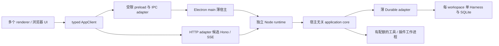
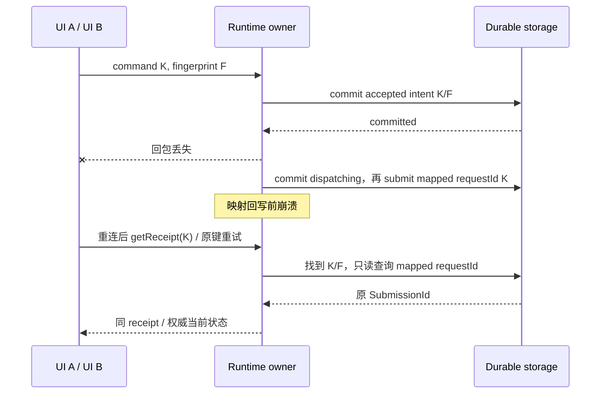

# Runtime、命令交付与故障恢复

日期：2026-10-19。状态：设计提案，未实现、未做运行或故障测试。遵循[架构决策](../ARCHITECTURE.md)与[工程原则](../ENGINEERING-PRINCIPLES.md)。本文依据本地源码 SHA `1402973a9dbe8c627341e04c9744c54953e285ca`；PI Durable 仍为 Experimental。文中的 AppClient、receipt、epoch、调度配额均为产品新增契约，不是上游已有 API。

## 1. 首先保证用户能回答三个问题

“提交后窗口断了，这件事到底开始了吗？”“取消是否真的停止了外部操作？”“更新后还能接着工作吗？”可靠性设计必须给这三个问题可核对的答案。

本设计的底线：

1. 只有提交到权威存储的事实才能显示为已接受；网络超时显示“确认中”，不能显示“提交失败，可以再发一次”。
2. 每个数据目录只有一个执行事实写入者。多窗口只观察和提交命令，不各开 Harness。
3. UI 重载只丢可重建视图；已接受命令、执行事实和外部结果核对线索仍在。
4. 本地事务不覆盖远程服务或操作系统副作用。恢复可能需要用户核对，不能承诺 exactly-once。
5. 自动恢复有预算。磁盘不可写、迁移失败、反复崩溃时宁可停下，也不持续重放有副作用的工作。

## 2. 进程与数据所有权



- main 仅拥有窗口、菜单、OS 集成、runtime 监管和传输桥；不执行模型循环、业务授权或数据库写入。main 也不得为了故障展示而直接打开第二个可写 SQLite 连接。
- 独立 Node runtime 拥有应用用例、workspace owner 注册表、命令接收、Durable 与资源调度。核心依赖存储、时钟、授权、执行等端口，不导入 Electron、Hono 或 HTTP request。
- 建议每 workspace 一份 SQLite、一份 Harness，内部可有多个 Conversation。Session/Harness 是内部运行实例，不是 UI 聊天。app-wide 索引只保存 workspace 定位和用户设置，不复制任务生命周期。此存储与运行实例粒度为待验证 ADR，不代表每 workspace 必须各占一个 OS 进程，也不形成 Docker 容器或权限沙箱。
- 最小实现可在一个 runtime 管理有限数量的已打开 workspace；关闭闲置 workspace 的 observer/cache，但有活动工作的 Harness 不被缓存淘汰。单个 workspace 的存储失败可关闭其 Harness；runtime 自身 OOM 仍影响全部 workspace，必须明确这个故障域。
- 上游调用和状态对象不能出现在 renderer。UI 只接收浏览器安全 DTO；IPC 和 HTTP 入口都验证 schema、协议版本、来源与工作区授权。运行时选择属于组装入口，页面不分支判断 Electron。
- main↔runtime 的本机通道候选为带 framing 的受控子进程通道；实际启动方式、消息限制、退出通知与打包兼容需验证。不为桌面强制开 HTTP 端口。HTTP/Hono 与 SSE 只作为同一契约的另一入口候选；loopback 同样需要凭据、Origin/CSRF 边界、连接限额，不能凭 CORS 充当认证。

### 单写入者不是一个 PID 文件

启动时先规范化数据目录身份，避免相对路径、符号链接、大小写别名重复打开；取得 OS 支持的独占锁后才能读写或恢复。锁需关联安装/profile、目录身份、owner incarnation；只记录 PID 不足以防 PID 重用。第二个宿主应连接已验证 owner 或报告“工作区被占用”，不能删锁强开。

owner 消失后，先证明旧进程及其写入能力已结束，再重开数据库。heartbeat 超时只说明不可达，不能据此产生第二个 owner。网络共享目录和同步盘上的锁、SQLite 与文件替换语义另做验收；未证明前不支持把活跃数据目录放在那里。上游 Storage 明确不提供跨进程锁，产品必须补齐。

## 3. 已核实的上游能力与不能推导的承诺

| 源码依据 | 实际行为 | 产品需要补齐 |
| --- | --- | --- |
| [submissions.ts](../../../packages/durable/src/harness/submissions.ts) | `Conversation.submit()` 在 commit 内以 conversation + requestId 找已有 submission；已有记录只比较 input/write 类型，不比较同类型内容 | 身份/命令作用域、载荷冲突检测、其他命令回执；不能把重复键新内容静默当旧内容 |
| [transaction.ts](../../../packages/durable/src/session/transaction.ts)、[session.ts](../../../packages/durable/src/session/session.ts) | staged writes 通过 Storage commit 成功后采用并发布；submission、entry、task、document 有事务机制 | 不深层导入内部 admission 函数，不假设应用 SQL 表与另一数据库能共同原子提交 |
| [observation.ts](../../../packages/durable/src/session/observation.ts)、[events.ts](../../../packages/durable/src/harness/events.ts) | watch 有界积压，达到阈值以新快照替换；`watchEvents()` 提供初始 snapshot 和按 commit 推导的事件 | 公共 epoch/watermark、大小限制、分页与断线恢复；不是无限或跨重启事件日志 |
| [Chord state.ts](../../../packages/chord/src/state.ts) | subscriber 初始 hydrate；最多 100 个待交付更新，溢出保留较新值，sequence 可跳；退订不等待已经运行的 callback | 不能把 sequence 当持久数据库版本；传输层必须识别完整替换与不可应用的增量 |
| [tool.ts](../../../packages/durable/src/harness/tool.ts) | 工具执行前持久化 intent；恢复仅在已存策略与当前策略均为 `safe` 时重跑，否则报告 interrupted，可能已部分执行 | 为具体工具证明 safe；结果未知、外部查询/核对、权限撤销，不是一次设置 safe 就有幂等保证 |
| [scheduler.ts](../../../packages/durable/src/harness/scheduler.ts) | 重开把 surviving running 转 pending 并计 restart；有 restart limit 和 blocked 原因；close 信号并 join，正常停下的运行任务回 pending | 宿主启动预算、全局资源公平性、无法合作的任务强制清理；不能把 `close()` 等同于用户 cancel |
| [SQLite Node adapter](../../../packages/chord/src/sqlite/node.ts) | `node:sqlite` 同步执行包装为 Promise，单连接操作排队，`BEGIN IMMEDIATE`，WAL + synchronous NORMAL | 独立 runtime 防主进程阻塞；NORMAL 不保证断电最后提交存活；FULL 或其他耐久策略须实测并评审 |
| [Node env](../../../packages/durable/src/env/node.ts) | POSIX 尝试 kill process group 再 PID；Windows 启动 `taskkill /F /T`，部分失败被吞掉 | 进程树清理完成证据、宿主死亡后孤儿回收、Windows Job Object 等方案的三平台验证 |

这些是源码核对，不是已运行的正确性证明。上游 watchdog、watch、任务图也不能替代客户端的授权和资源边界。

## 4. 命令回执：丢失回包不等于丢失工作

### 4.1 身份与状态

每个用户意图在首次发送前生成稳定 requestId；一次传输重试沿用，用户明确发起新意图才换。服务端从已认证连接生成 principal，不信任请求体自报身份。

去重作用域建议为 `(storeIdentity, principalId, workspaceId, commandKind, requestId)`；命令目标和语义载荷参与 fingerprint。目标也参与比较，因此同 scope/key 改成另一 conversation 必须冲突。不同身份不得用查回执接口探测别人的键。receiptId 独立于连接、窗口与进程重启；SubmissionId 是用户输入在 Durable 中的稳定追踪，不用会随 generation 改变的 `pi.live.run.taskId` 充当整次请求 ID。

产品回执保存“命令交付状态”，不另建可独立写入的 task/run 状态机：

- `accepted`：经过校验授权，意图及 fingerprint 已持久保存，尚不意味着 Durable 已启动。
- `dispatching`：分发尝试已持久登记，可能已进入 Durable；映射缺失不能证明尚未执行。
- `dispatched`：已能关联权威 SubmissionId 或对应持久命令效果。
- `suppressed`：取消与分发经过同一 owner 的串行判定，已原子记录禁止分发；确认没有已接收的 submission 或仍在途的分发，不再创建 submission。
- `rejected`：接受后执行前条件变化，命令未执行，提供原因。
- `reconciliation_required`：分发或外部结果无法安全判定；保留证据和下一步。

是否排队、执行、完成来自 Durable 的查询投影；外部效果是否确认另带核对状态。不把“accepted”和“成功完成”压成一个 success 布尔值。

### 4.2 原子接收与恢复协议

优先将有界分片的应用 receipt/intent 文档放入所属 workspace 的 Durable 存储，通过公开 document/commit 能力持久化，由同一 owner 串行比较键并接收。禁止一个无限增长的大 JSON receipt 文档。分片、索引、分页和清理能力必须在 spike 中验证；若公开文档能力不能满足规模，则评审扩展存储接口，不绕过上游内部事务队列写 SQL。

1. 校验身份、授权、配额、版本、目标与载荷。fingerprint 对校验后的 canonical command 计算，包含会改变语义的字段与契约版本；排除 traceId、超时时间等传输信息。内容敏感时使用带密钥摘要，原始输入只放必要的受保护 intent，不进入日志。
2. 在单 owner 的接收事务中查询键。相同键/相同 fingerprint 返回同一 receipt；不同 fingerprint 返回 `IDEMPOTENCY_CONFLICT`，绝不覆写、追加执行或静默返回旧内容。并发窗口的相同键只允许一次接收。
3. 新意图持久化完成后才返回 accepted。禁止先发模型请求再补回执。持久提交结果不明确则返回 `ACCEPTANCE_UNKNOWN`，客户端查原键，不自动生成新键。
4. 分发与按 receiptId 取消使用同一 owner 的每意图串行控制线。首次分发前重新鉴权、检查配置 epoch，并原子将 accepted 改为 dispatching、记录 mapped requestId 与尝试标记；已 suppressed 不得 dispatch。随后调用公开 `Conversation.submit()`，回写 SubmissionId。不要直接导入内部 `admitSubmission()`；标记、submit 与映射是可恢复步骤，不谎称一个事务，也不持有数据库事务跨越外部工作。
5. dispatching 或映射缺失的恢复必须先只读查 mapped requestId。已有 submission 就补映射、保留已发生的事实，即使权限已撤销或配置 epoch 已变化也不得改称“未执行”；后续新效果仍重新鉴权。确定不存在，且不存在旧 owner/在途分发后，才按当前授权与 epoch 决定重新 dispatch、suppressed 或 rejected。查询失败、不可用或存储回退使结论不可信时进入 reconciliation_required；不得用可能新建工作的 submit 冒充查询。公开 `Storage.submissionByRequest` 与 `Tx.submissionByRequest` 有查询契约，但应用适配层如何在唯一 owner 内安全串行调用、且不意外恢复调度，必须验证；未验证前不提供自动恢复承诺。所有入口仍需同一 payload conflict 检查，不能让插件旁路。
6. 非 submit 命令逐个定义效果识别和重试语义：撤销某个已命名 submission 可查询其终态；取消指定任务应对固定目标实施。禁止用无目标的“取消当前 run”恢复后误取消新工作。无法去重/核对的命令保持未知，不自动重放。

按 receiptId 取消尚未 dispatch 的 accepted intent，必须在同一串行控制线的事务内将其改为 suppressed，回执查询返回这个稳定结果；不能只调用尚不存在的 Submission.abort。若 dispatching 已先发生，则持久记录取消请求并先核对映射，不能声称“从未执行”。找到 SubmissionId 后按 queued/placed 实际阶段撤回或取消指定执行；确认没有 submission 且没有在途分发，才转 suppressed。取消请求本身也有 requestId，并不因原窗口断线丢失。

权限撤销或配置 epoch 失效只对确认尚未分发的意图作 rejected 判定；分发状态不明必须先按上述顺序核对。撤权与新效果授权必须在可信 broker 上有明确的先后判定点：该点之后不再授予已撤销能力。已经授出的句柄、在途网络请求、Node 插件直接进行的 OS I/O 不能据此追溯阻断；取消或终止是尽力清理，仍须核对效果。未经过 broker 的代码不在这一撤权保证内，必须通过隔离约束或禁止该执行方式控制风险，不承诺“撤权后所有副作用归零”。

运行中改变 cwd、工具或模型语义的策略与[领域设计](SESSION-DOMAIN.md)一致：产品若承诺整轮固定配置，必须冻结实际执行配置或拒绝运行中修改，不能仅存一个无执行作用的 epoch。

回执查询同时支持 request scope/key 与 receiptId；未授权资源与不存在避免不同响应泄漏。`not_found` 只说明该权威存储当前没有记录，灾后恢复了较旧备份时不能证明外部操作没发生。显示数据恢复 incarnation 变化并阻止盲重发。

保留期不能随便定成“7 天后重用”：未决/未知 intent 不清理；终态可压缩为键、fingerprint、目标、最终映射的 tombstone。最小方案在同一 store incarnation 内保留这些键证据，不允许清掉 tombstone 后把旧键当新意图。若以后需要有限保留期，必须先引入并验证可认证的请求窗口/客户端 epoch，服务端拒绝过期窗口的新建请求，不能相信客户端自填时间。只有保留的 tombstone 或可认证窗口能够证明过期时才返回 `RECEIPT_EXPIRED`；裸随机键已完全删除就无法区分新旧，不得声称能够识别。配额、隐私删除、窗口轮换与重放测试通过之前，不承诺终态去重记录可安全清理。数据目录清空、备份回退及跨账号导入必须换恢复 incarnation、提示核对，不能静默恢复原来的去重保证。

### 4.3 传输无关接口草图

以下是概念形状，不是可直接编译代码，也不是 PI API：

```text
AppClient.command(CommandEnvelope, waitSignal?) -> CommandReceipt
AppClient.getReceipt({ workspaceId, requestId, commandKind } | receiptId) -> ReceiptView
AppClient.query(QueryEnvelope, waitSignal?) -> VersionedSnapshot
AppClient.observe(SubscriptionRequest, listener, waitSignal?) -> SubscriptionHandle
SubscriptionHandle.dispose() -> releases local wait + remote subscription
CommandEnvelope = protocolVersion + workspaceId + requestId + typed command
PublicError = code + requestId + retryDisposition + safeMessageKey + safeParameters
```

waitSignal 只终止传输等待。服务端已开始接收时不得把客户端断开直接传给执行的 AbortSignal。HTTP 可以用 202 表达持久 accepted，409 表达键冲突/资源版本冲突；IPC 使用相同业务错误码。HTTP 具体路径、schema 和 OpenAPI 由契约统一生成后验证，不能手写第二套含义不同的 DTO。

## 5. 状态分层与 snapshot + delta

### 5.1 三类状态

| 所有者 | 内容 | 重载后的来源 |
| --- | --- | --- |
| Durable + 应用持久元数据 | submission/task/document、接收 intent、授权与效果核对依据 | 权威存储，非 Query cache |
| runtime 读投影 / TanStack Query | 任务列表、当前 transcript 窗口、文件状态摘要 | 有界 snapshot + 分页历史，可随时丢弃重建 |
| UI 交互状态 | 输入草稿、选择、展开、滚动锚点 | 本地草稿恢复或用户继续；不得反向覆写执行事实 |

缓存 key 包含 server/store identity、principal、workspace、资源与 query shape。切身份、服务或撤权时同步撤订阅并清对应缓存；本地持久 Query cache 不是凭据库，也不能当离线权威事实。离线输入默认保留为草稿，不悄悄排队成待执行命令。

### 5.2 没有快照交界点，重连必然有洞

错误例子：先 GET snapshot，再开流；两步之间的一条“任务完成”永远收不到。

建议 `observe` 是一个原子“取得投影 + 挂接观察”的服务操作。产品流的 envelope 包含 `streamEpoch`、`scope`、`projectionVersion`、`baseVersion`、`kind` 与内容。epoch 每次 owner/投影重建改变；version 在该 epoch/query 内单调递增，不把上游局部 sequence 当跨进程版本。

- 在同一串行投影发布线上注册观察，取得版本 W 的 snapshot，再按序交付其后的更新；快照构建中的更新先进入有界缓冲。必须使用上游已提供的原子 watch acquisition 或经验证的适配协调，不实现“先读再订”竞态。
- 第一帧 snapshot 带 watermark W；delta 仅在 `epoch` 相同且 `baseVersion == localVersion` 时应用。重复帧忽略；乱序、缺口、未知 schema 立即停止增量，标记 stale 并重取快照，不猜 patch。
- 过滤掉无关 commit 时，使用投影自己的连续版本，不能假设 Durable 全局 seq 连续。完整 replacement snapshot 可跳版本；delta 不可跳。
- runtime 重启 epoch 改变，强制 snapshot。短断线若仍在内存 ring 覆盖内可重放；否则发送 `reset_required`，重新取得 snapshot。游标必须绑定身份、scope、查询条件和 epoch，不能换 workspace 使用。
- SSE `Last-Event-ID` 只是续接请求；服务端仍校验范围与保留窗口。心跳只检测连接，不代表任务进展。代理缓冲、浏览器连接配额、认证刷新需专项验证。

上游 `watchEvents()` 当前快照包含 conversation entries，不自动等于产品有界视图。长会话不能先构建完整 snapshot 再在 HTTP 出口截断以假装内存有界。spike 必须证明基于分页 entries + 小型 live 状态的有界投影如何保持同一交界点；若公开能力不足，需要独立评审上游适配改动，这是长会话发布门槛。

### 5.3 背压与容量

每条订阅同时限制条目数、总字节、单帧字节、快照构建内存和写出时间。100 个上游 frame 不是字节上限，一个巨大 frame 仍会 OOM。

慢 UI 不阻塞存储 commit 或 Agent。允许合并显示进度、连续文本更新；不能丢掉命令 receipt 或权限决策等事实，只能让消费者重拉权威状态。超限丢弃未发送增量并发送 reset 提示；连提示也无法发出就断开连接。重复慢消费者需退避，防止不停全量 snapshot 成为新的放大器。历史按固定上限分页，导出单独流式处理；不引入无限 replay log。

大工具输出在生产端设限并落受控 artifact，事件只带摘要与 resource ID；不能把全部 stdout 留在父进程再截断。UI 退订后丢弃迟到 callback，等待必要清理，不把上游 `stop()` 误读成已 join 全部 callback。

## 6. 并发、公平与重任务隔离

仅“并发 4 个任务”不能防止一个任务解析巨型文件耗尽内存。最小可靠方案同时覆盖 admission、执行和输出：

- admission：每 workspace 和全局有等待数/字节上限，达到上限返回可重试的 `CAPACITY_EXCEEDED`；不无限收 accepted intent。等待项必须可查看、撤销；高权限请求不绕过预算。
- 调度：各 workspace 队列轮转，队内按接收顺序并允许等待老化；给交互命令、查询与取消预留控制通道。持有任务不得在等待子任务时占满所有执行 token，父子依赖要能让出资源，避免“所有父任务等孩子、孩子无槽位”的死锁。
- 配额：分别约束模型请求、工具执行、文件预览、打开 Harness 数量、输出速率和磁盘占用；上游 scheduler 不被默认当成跨 workspace 公平调度器。工具 wrapper/执行端口在真正产生工作前获取许可，包括重启恢复与插件嵌套调用；只限制 UI submit 会漏掉后台工作。
- CPU/内存重操作放工作进程，预检文件/输入大小，流式解析，限制 worker 数与输出；未知或不可信工具不能在唯一 owner 的 JS 事件循环直接执行。监测 RSS/heap/事件循环延迟可用于停收与诊断，但周期采样本身无法保证在 OOM 前阻止分配。
- 硬内存/进程树限制需 OS 级机制验收；只设置 V8 heap 上限不限制 native buffer、子进程或整个树。平台不支持已承诺的隔离时，要限制工作负载/拒绝重任务，而不是声称已安全支持。

先建立空闲、长会话、多 workspace、重工具与慢 UI 的三平台 baseline，再定并发数、字节上限、启动/交互/恢复预算。实施前必须填写所有 limit，禁止把“待测”落成 Infinity；数值随支持硬件分档，所有默认值需在发布配置中可追溯。最小实现不使用微服务、Redis、broker 或通用分布式调度平台。

## 7. 取消、关窗、退出与进程清理

| 操作 | 明确语义 |
| --- | --- |
| cancelWait / 页面卸载 / 断网 | 取消当前 query/receipt 等待和订阅，释放资源；不提交执行取消 |
| 撤回待处理输入 | 映射前指定 receiptId，原子 suppressed 或先核对；映射后用 SubmissionId，上游只能撤回 queued，placed 返回已经放入执行，不伪称撤回成功 |
| cancelRun | 授权命令，固定目标及明确是否包含 background；持久取消意图之后等待协作退出，不能撤销已发生效果 |
| 关闭窗口 | 销毁该窗口订阅，运行策略独立；其他窗口无影响 |
| 退出宿主 | 停收、保存、关闭 runtime，区别于永久取消；下次按恢复策略继续或等待用户 |
| 强制结束 | 中断进程，未保存尾部和正在发生的外部效果可能未知；下次核对，不显示全部取消成功 |

最后窗口关闭后的后台常驻是产品待决策略，不能沿用某平台默认行为默默决定。建议有活动工作时明确给出“保留后台运行 / 保存并退出”及实际影响；没有验证后台宿主前不提供虚假选项。OS 注销、系统强杀不保证对话框或清理时间，正确性必须来自先前的持久提交。

### 分层 shutdown

1. main 停接新窗口命令；runtime 进入 draining，返回恢复提示。先记录可持久化的交付状态，保留已接受 intent；UI 草稿另行保存。
2. 解除订阅与临时预览；停止 admission/新外部 dispatch。已在接收事务中的请求先完成提交或确定失败；不能返回 accepted 后把队列扔掉。
3. 若用户选择永久取消，先写明确目标的取消意图；若只是退出，不把所有任务标为 aborted。调用 Harness 正常关闭让任务协作退出、已提交 checkpoint 留存；上游 close 可能等待不理会 signal 的代码。
4. 给工具、MCP、插件执行进程发送终止并等待退出，核对整个受控进程树。然后关闭存储、检查 flush/close 结果，再写 clean-shutdown 标记并释放 owner 锁。标记不是存储事务或数据完整性的替代证明。
5. 到达 grace budget 仍未完成，UI 说明“部分操作状态待核对”，允许用户选择继续等待或强制退出；OS 强制关机走同一未完成记录语义。强杀前若存储不可写不能保证写入告警，下一次通过缺少 clean marker 与 surviving intent 识别不干净退出。

POSIX process group 不覆盖主动脱离组的后代；Windows taskkill 不等于已等待树清空。候选 Windows Job Object、POSIX 受控进程组/监管器需验证宿主骤死、双重 fork、孙进程、PID 重用和权限不足。不能根据保存的旧 PID 杀当前无关进程；进程身份与 owner incarnation 必须匹配。收不到清理确认时保持“可能仍在运行”，不擅自启动冲突工具。进程隔离也不等于文件/网络权限沙箱。

## 8. 崩溃、存储、外部副作用与升级

### 8.1 恢复有界，失败可见

监管状态建议为 starting → ready → draining / degraded → stopped；崩溃可进入 recovering，耗尽预算进入 needs-attention。main 只监管进程，不代写 Durable 状态。

区分三层预算：模型/网络单次重试、Durable task restart limit、宿主 runtime 重启窗口。它们不能相乘形成无穷重试。短时间重复崩溃使用退避及抖动、同原因累计、最大启动尝试/总时长；稳定运行足够久后才清预算。确切数字由故障 baseline 确定。自动重启前确认旧 owner 已结束，检查存储健康与 schema；磁盘满、权限错误、损坏、迁移不兼容不自动重启风暴。

上游 storage 错误会使 Harness fail/close，不能继续持有该 Harness 接受命令。停止受影响 workspace admission，取消其执行信号，保留诊断并展示只读的已知快照（标注时间/stale）。修复条件满足后重新打开，核对 accepted intent、SubmissionId 和工具 intent；不要复用已失败对象。上游 task 被 restart limit 停放时展示具体 blocked 原因，用户显式恢复之前不反复清计数。

### 8.2 存储故障的边界

- SQLite 事务原子性不是断电耐久性；当前 NORMAL 可丢最后已返回提交。要承诺断电不丢 accepted，必须评审同步策略、磁盘/文件系统与宿主测试，不仅修改文案。receipt 与 task 使用相同耐久边界，不能回执比执行更“耐久”。
- disk full / I/O error / 权限丢失：停新工作，释放临时可再生缓存，保留用户内容和待核对记录，不擅自删历史腾空间。只读诊断能否继续由后端实际状态决定，不在错误连接上无限尝试读写。
- 数据损坏：不自动重建空库。保留原文件和 WAL，提供验证过的备份恢复流程；备份需要 SQLite 一致性方案，不只复制运行中的 `.db` 忽略 WAL。
- receipt、应用文档与执行事实需要协调时使用同存储可验证事务；设置等独立元数据若在另一存储，只能声明最终协调，不假设跨库事务。禁止在 SQLite transaction 内进行网络调用或等待子进程。
- 清理历史必须保留未决 receipt、效果核对、授权审计及恢复依赖；压缩与清理也需限速及中断安全，不能在启动热路径无界 vacuum。

### 8.3 “结果未知”是需要完成的工作

外部操作遵循：持久化 effect intent → 执行 → 持久化可验证 receipt/结果。intent 包含稳定 effect ID、目标摘要、授权引用、幂等键、执行尝试与核对方式。不要在日志存完整敏感请求。

若远端接受后本地尚未记录就崩溃：

- 远端支持幂等键且保留期覆盖恢复：使用同一 key 查询或按其协议重试，验证相同目标/载荷；“HTTP 超时”不是新 key 的理由。
- 支持只读结果查询：按远端 operation ID、业务引用或文件版本/hash 核对，并记录证据。
- 不能可靠核对：标记 reconciliation_required，停后续依赖，给用户目标、可能影响和核对动作；必须获重新执行授权才产生新的副作用尝试。

文件写入也可能部分成功，需同目录临时文件/替换策略、目标版本比较与结果 hash；跨文件批量修改不天然原子。取消后清理临时文件不等于回滚远端发布。`replay: safe` 必须由工具实现证明，包括重启后配置/权限变化，而非由模型自己声明。

### 8.4 休眠、断网与更新

休眠恢复后重建连接，更新时钟视图并核对过期授权/外部状态；用单调时钟量进程内耗时，持久截止时间记录 UTC，检测墙钟大幅跳变。不在唤醒瞬间补发所有过期定时动作，按语义合并或要求核对。断网时允许看带 stale 标识的缓存和写草稿，停止无证据的外部重试；网络恢复后先查未知 receipt。

更新顺序：验证包来源/完整性与兼容 manifest → 排空新 admission → 正常停 runtime → 一致性备份和空间预检 → 持独占锁迁移 → 新版本只读/受限自检 → 恢复调度。迁移有版本、可中断恢复点和失败记录；不在旧 runtime 仍写入时迁移。二进制回滚与数据库恢复分别设计，不允许旧版本写新 schema；不兼容则停在可诊断界面。外部副作用不会随备份回滚撤销，因此恢复后要核对数据回退期间的效果，不自动补跑。

## 9. 三段故障时序

### A. 回执丢失，两个窗口重发



断言：只有一次用户输入进入 Durable；改变 F 返回冲突；UI 不根据断线复制新任务。若最后事务遭断电丢失，此结论受实际耐久策略限制，必须单独测试。

### B. 慢窗口错过完成事件

窗口停在 epoch E/version 40；生产到 90，缓冲达到字节上限 → runtime 删除待发增量并要求 reset → UI 保留旧内容且标 stale → 原子 snapshot@95 → 应用 95 后的 delta。若 runtime 同时重启变 E2，旧 E 的帧全部丢弃。断言：最终完成态正确，峰值缓冲有上限，不需要重放所有 token。

### C. 发布已成功，本地磁盘满

工具 intent 已落盘 → 外部服务完成发布 → 本地结果 commit 报磁盘满 → Harness 失败，UI 显示“发布结果待核对” → 停收相关工作，用户腾出空间 → 重新打开 → 按 effect ID 查询远端 → 确认已发布并保存证据。若远端不可查询，保持未知并请求核对。断言：任何阶段均不自动再次发布，退出/取消也不改写成“没有发布”。

## 10. 验证矩阵：必须能精确打断的 failpoints

测试使用确定性假模型、假外部服务、可控时钟和可注入失败的 Storage；涉及进程/磁盘/平台的项目另需真实目标 OS。此表是待实施验收，不是已经通过。

| 注入位置/场景 | 必须观察的结果 |
| --- | --- |
| receipt commit 前、commit 返回不明、commit 后回包前 | 未持久不能 accepted；重连查原键；同键并发不重复，异载荷冲突 |
| submit 成功后、receipt 映射回写前 SIGKILL | 重开关联原 SubmissionId；不追加第二份用户输入 |
| 上述窗口崩溃后撤权/改变配置 epoch；只读查询失败 | 已存在 submission 补映射，不伪称未执行；确定不存在才按新授权决定；查询不可靠保持未知，不用 submit 探测 |
| accepted 取消与首次 dispatch 同时发生；dispatching 时取消后崩溃 | 取消先提交则 suppressed 且无 submission；分发先提交则核对后撤回/取消，持久取消意图不丢失 |
| tombstone 清理、旧随机键重放、请求窗口伪造/轮换 | 未具备可认证过期判定时不清键证据；旧窗口拒绝；不能把完全遗忘的旧键误判为新请求或虚报 expired |
| 身份切换、撤权、同键不同 workspace/目标 | 查回执/订阅无越权；旧缓存撤销；目标变化不静默复用 |
| snapshot 获取与挂观察交界处连续提交 | 无丢更新；W 与第一条 delta 连续；历史分页与 live 一致性有证据 |
| 重复/乱序/gap/epoch 切换/游标过期 | 丢弃不可应用增量，重建快照；不存在永久错误完成态 |
| 单帧巨大、慢 renderer、HTTP 阻塞、退订 callback 迟到 | 有字节上限、断流/reset；执行不受慢 UI 拖累；资源回到基线 |
| cancelWait 与接收/提交竞争；取消与完成竞争 | 停等待不取消任务；取消目标固定；完成与取消只显示实际先后事实 |
| 父任务等子任务、两个 workspace 重负载 | 无 token 死锁/饥饿；控制命令可响应；排队/拒绝原因清楚 |
| 重工具 native 内存膨胀、stdout 洪泛、解析炸弹 | 工作进程终止或拒绝；owner 不被输出拖垮；残余影响可诊断 |
| runtime 崩溃、main 崩溃、重复启动、别名目录打开 | 无双 owner；预算耗尽停机；不会仅凭 heartbeat 超时夺锁 |
| 工具子孙进程忽略 signal / 脱离进程组 | 三平台记录残留与清理证据；不得宣称树已停而实际仍写文件 |
| 工具效果发生前后、结果 commit 前后崩溃 | safe 依据可验证；unsafe 不盲重放；未知有查询或人工路径 |
| ENOSPC、只读、I/O error、关闭/flush 失败 | Harness 失效后不再接收；原数据保留；不无限 reopen |
| WAL 存在时备份、模拟断电、数据库损坏 | 恢复符合选定耐久声明；不会空库启动掩盖数据丢失 |
| 休眠/墙钟跳变/离线/认证过期 | 不重复副作用；授权重新校验；不因旧连接状态伪称运行正常 |
| 迁移各阶段崩溃、空间不足、新旧版本互开 | 要么旧数据可恢复，要么新 schema 完整；旧程序拒写不兼容库 |
| shutdown 每层 timeout / 强杀 | 无虚假 clean 标记；下次恢复展示未知；被保存 intent 可查询 |

三平台还需覆盖独立 Node 分发路径、Electron 内嵌 Node 与 runtime ABI/版本、`node:sqlite` 可用性、签名/安装权限与更新失败。运行证据要记录硬件、系统、数据规模、峰值 RSS、队列字节、延迟分位、恢复结果与残留进程，不以一次截图或编译通过替代。

## 11. 诊断与本地指标

结构化日志包含 store incarnation、workspace 的脱敏标识、requestId、receiptId、SubmissionId、taskId、effectId、attempt、阶段、错误码与时间；身份令牌、模型正文、文件内容、真实私密路径、完整 shell 参数默认排除。ID 本身也按用户数据保护，不进入 URL 或公共服务。

本地记录启动/恢复耗时、接收/分发延迟、排队年龄、活跃任务/worker、RSS/heap、事件循环延迟、存储错误、订阅积压字节、reset 次数、未知效果数及 restart budget。默认不外发遥测。日志轮转、诊断包上限/保留期需在 baseline 后定值；磁盘满时诊断失败不能再触发递归写日志。

导出诊断前展示范围并脱敏，可预览；原始用户内容默认不包含。崩溃转储可能含内存中的秘密，不能自动上传。支持复制稳定错误码与关联 ID，方便用户报告而无需贴完整工作内容。

## 12. 小型 ADR 与实施阻断项

| 决策提案 | 为什么 | 放弃/延后的替代方案 | 锁定前证据 |
| --- | --- | --- | --- |
| 薄 main + 单独 Node runtime | UI/OS 响应与执行隔离，核心可单独测试 | 在 main 执行 Agent；直接 renderer 使用 Chord | 三平台启动、IPC、崩溃、打包与 Node/SQLite 兼容 |
| workspace 单 storage/单 Harness；共享有限 runtime | 权威清楚、损坏边界小，避免重复生命周期 | 每窗口 Harness；每任务一库；先拆微服务 | 多 workspace 资源、锁、关闭/恢复测试 |
| durable intent + 可恢复 submit 映射 | 不依赖上游私有 admission API，覆盖回包丢失 | 双库“假原子”；直接信任上游同键同 type 去重 | 文档分片/索引规模、两步崩溃窗口、键冲突一致性 |
| snapshot + bounded delta，必要时 reset | 视图可恢复且成本有界 | 永久 token event log；仅 GET 轮询；无限 SSE 缓冲 | 原子交界点、有界长历史、慢消费者基准 |
| HTTP/Hono + SSE 为候选 | 单向状态流足够，不增加双向协议复杂度 | 当前就 WebSocket/公网服务 | 契约同测、认证与代理/断线测试 |
| 资源配额 + 重工具进程边界 | 单 heavy 工作也不能拖垮 owner | 仅限制并发数；所有插件进同 Node | OS 限制/树清理、内存洪泛、子任务公平性 |
| 先停机再迁移，有预算恢复 | 比不停重启和静默损坏更可信 | 热迁移活跃库；任意二进制降级 | 故障注入、备份还原与外部效果核对 |

开始实现前必须解决：公共 receipt 存储形状与保留策略；不读取整段历史的原子订阅投影；恢复/嵌套调用也受配额的执行入口；三平台单 owner 与进程树 cleanup；支持硬件上的预算；退出后台策略；数据库断电耐久目标。上述未闭合时可以做 spike，但不能把客户端标为生产可靠。
