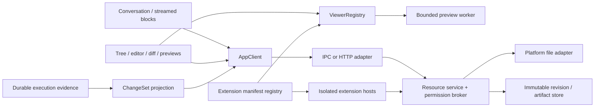

# 工作台、设计系统与扩展契约

日期：2026-10-19。状态：详细设计提案，待评审与实现验证。本文细化[工作台要求](../WORKBENCH.md)、[产品原则](../PRODUCT-PRINCIPLES.md)及[架构边界](../ARCHITECTURE.md)，不宣称候选库、沙箱、恢复或插件生态已实现。具体依赖版本、性能预算和首版范围仍需锁定证据。

## 1. 决策范围与术语

目标是让同一套工作台在 Electron IPC 与浏览器 HTTP 下查看真实成果、保护用户编辑、承载可治理的扩展。六个标签的落点分别为：跨平台资源语义、完整视觉系统、可预测交互、真实扩展契约、版本证据、可恢复的有界异步处理。

- **Workspace**：文件根、授权与运行环境的产品边界；不是任意本机路径字符串。连接身份和 workspace 共同决定资源命名空间。
- **Conversation**：用户可恢复的对话，与 Durable transcript 对齐；不是编辑器实例。
- **Receipt**：公共请求被接纳后的稳定锚点，使用 `receiptId`；接纳不等于已经 dispatch 或开始执行。
- **Submission**：dispatch 后映射的执行请求，使用实际 `submissionId` 关联执行与资源证据；映射前只关联 receipt，不生成虚假的 submission 或 run。
- **Run**：供 UI 展示的执行投影，不以可能随恢复 generation 变化的内部 `pi.live.run.taskId` 充当稳定产品标识。
- **Task**：Durable 的执行任务。用户请求的资源变更集合命名为 `RequestChangeSet`，通过 receipt 与实际 submission 关联，不按内部 task ID 推断归属。
- **EditorBufferSession**：一个窗口中某资源的编辑草稿、选择及撤销历史；与 Session/Harness 内部运行实例、Conversation 持久历史均无关。

本文不设计完整 VS Code 兼容层、不承诺 Office 编辑、不扩张为多租户服务，也不复制 Durable 执行状态机。每 workspace 存储与单 Harness 的具体布局由运行时设计决定；工作台仅依赖资源和投影接口。



UI 与契约无 Electron/Node 依赖，core 不依赖 HTTP 框架；Electron main 保持薄壳。图中 worker 和 extension host 表示责任与故障边界，不自动表示权限沙箱。

## 2. 统一资源模型

### 2.1 引用固定版本，发现最新版本使用另一个操作

问题：成果消息链接到 `report.docx` 后，Agent 下一次写入同名文件，历史消息会展示新内容。解决：不可变版本引用与“查看最新”选择器分开。示意类型为公共契约提案，不是现有 SDK：

```ts
interface ResourceKey {
  workspaceId: string;
  resourceId: string;
}
interface ResourceRef extends ResourceKey {
  revision: string;
  contentType: string;
}
interface ResourceMetadata {
  ref: ResourceRef;
  displayName: string;
  byteLength: number;
  kind: "file" | "directory";
  availability: "available" | "expired" | "deleted";
  writeMode: "managed-cas" | "external-best-effort" | "read-only";
}
type ReadSelector =
  | { kind: "revision"; ref: ResourceRef }
  | { kind: "latest"; key: ResourceKey };
```

- `revision` 是服务端生成的不透明版本标识；客户端不得把 mtime 当版本，不以 revision 字符串排序。实现至少校验内容摘要及需要保护的文件身份/元数据。相同字节是否沿用 revision 必须由资源后端定义；身份变更、删除重建不能被相同路径掩盖。
- `contentType` 来自服务探测，是调度线索而非内容可信证明；扩展名与声明类型不一致时显示警告或降级。每次获取版本内容重新校验权限。
- `resourceId` 不等于路径或 inode。rename 只有在服务有可靠映射证据时保持身份；仅由 watcher 猜测的移动按删除/新增显示，不编造关联。大小写折叠、Unicode、Windows 保留名由平台 adapter 明确定义。
- latest 读取首先解析到固定 `ResourceRef`；分块、分页和范围读全部携带该 revision，不允许前半页和后半页属于不同版本。版本不可再读返回 `REVISION_UNAVAILABLE`，不能偷偷退到最新。
- 目录返回独立 listing revision、分页 cursor 和条目；游标过期重新列举，保留用户展开项与焦点。树是可重建读模型，watcher 只是失效线索，不能作为审计事实。
- Query 键至少包含连接身份、workspaceId、resourceId、revision 和读参数；切换连接清除对应订阅、预览、对象 URL 与缓存，避免跨服务同 ID 串数据。
- IPC/HTTP 均使用资源 ID，不向 UI 发任意绝对路径。字节传输走有配额的内容接口，不把整个文件塞进事件流或无限 base64 JSON。

### 2.2 权限与路径解析

资源服务按主体、workspace、资源、操作检查授权，文件树可见不等于可读取或可写入。HTTP 内容地址为受认证的资源端点；短时下载票据仅授权特定版本和用途，避免记录秘密 URL。

文件 adapter 必须处理目录穿越、符号链接、junction/reparse point、硬链接、替换父目录和目标身份变化。`realpath` 后做字符串前缀判断只解决部分问题：检查与使用间仍可能改变，称为 TOCTOU 竞争。需要平台级句柄相对访问、链接跟随限制、文件身份复核及允许根约束；跨平台不能实现同等保证时收缩操作范围或拒绝危险路径。不要把 JS 路径过滤包装成强沙箱。

对于恶意同用户进程可重写授权目录的威胁，普通 Node 文件 API 与进程锁不足以保证边界；需要经过验证的 OS 约束或受管理存储。不能支持该威胁模型的平台应明确标注，并禁止把受限 Agent 指向仍可绕过 broker 的原始文件系统。

## 3. 编辑缓冲区、保存与冲突

### 3.1 状态归属

`EditorBufferSession` 保存 `bufferId`、ResourceKey、baseRevision、baseContent、当前文本、bufferVersion、dirty、selection、scrollAnchor、undoHistory。dirty 由当前文本与基线比较产生；不是执行状态，也不向 Durable transcript 逐键写入。

同窗口同资源默认复用 buffer，多窗口各有 buffer 并共享资源服务。只读预览不创建伪 dirty 状态。草稿恢复日志可持久到独立用户草稿存储，按身份/workspace 隔离、限额、可清除；日志含敏感正文，纳入存储保护。恢复草稿必须同时恢复 baseRevision，不能冒充磁盘事实；缺基线时进入“需比较”的恢复状态。

典型时序：

1. 用户读取 r1，编辑得到 buffer b2。
2. Agent 写出 r2；资源通知只将 buffer 标成 `external-change`，保留 b2 和撤销历史。
3. 保存以 r1 为 expectedRevision，返回冲突与当前 r2。
4. 三方比较 base=r1、ours=b2、theirs=r2；用户确认合并文本 b3。
5. 以 r2 保存 b3；若期间变为 r3，再次冲突，不能强写。

clean buffer 可按偏好自动刷新，但保留焦点与位置并显示版本变化；dirty buffer 永不被后台重载替换。目标被删除时保留草稿，提供另存为或经明确确认重新创建；不能自动复活已删除文件。

### 3.2 保存契约与回包丢失

```ts
interface SaveTextCommand {
  requestId: string;
  resource: ResourceKey;
  expectedRevision: string;
  bufferVersion: number;
  text: string;
  encoding: "utf-8";
  newline: "lf" | "crlf";
}
type SaveOutcome =
  | { kind: "saved"; ref: ResourceRef; bufferVersion: number }
  | { kind: "conflict"; current: ResourceRef }
  | { kind: "unknown"; receiptId: string }
  | { kind: "rejected"; code: string };
```

示例只展示 UTF-8 文本路径，其他编码须先探测并显式处理，不能静默转码。保存快照 b2 发出后用户继续输入 b3，回执只能将 b2 确认为新基线，b3 仍为 dirty，不能清空其撤销历史。保存排队按资源串行；新的保存携带对应快照和已确认基线，不并发发送两个依赖同一旧基线的写入。

requestId 对应有界幂等记录，包含载荷摘要；相同 ID 不同文本拒绝。回包丢失查询回执；不能以“超时”直接重新覆盖。写入发生而回执尚未持久时进入 unknown，核对目标身份、内容摘要及操作日志后再决定；不能由当前摘要相同推断所有副作用均完成。

### 3.3 CAS 与 atomic write 的真实保证

CAS 指“当前版本仍等于预期版本才提交”。必须报告后端的实际保证等级：

| 后端 | 可提供的保证 | 不能暗示的保证 |
| --- | --- | --- |
| 受管理版本存储，所有写入由同一协调者仲裁 | 在其事务/锁边界内执行 CAS，竞争写之一成功 | 未验证的磁盘断电持久性、跨多个文件事务 |
| 普通工作目录，UI 与受控工具均走 broker | 协调这些写入，复核当前内容，检测已观察到的外部变化 | 不受控编辑器、shell、Agent 直接写盘之间的严格 CAS |
| 外部/网络文件系统或能力不足 | 明示 best-effort，按证据拒绝/另存副本/只读 | watcher 无遗漏、平台相同的 rename/锁语义 |

强防覆盖是发布要求时，写入路径必须收敛到受管理存储/协作写入协议，或提供已验证的系统级保护。任意 shell 可直接写工作区时不能宣称已满足强 CAS；应禁用自动冲突覆盖，保留基线与用户草稿，提示风险并允许另存副本。`stat → hash → rename` 的最后间隙仍会丢失外部写入，不能靠再加一次 stat 消除。

原子替换方案在受支持文件系统上使用同目录临时文件、完整写入、必要同步、目标检查与替换；失败清理临时文件，权限/ACL/执行位按明确策略保留。保证只针对单文件替换的可见性，不自动包括多个文件、文件夹、跨卷、硬链接指向内容、所有网络盘或断电持久性。Windows 占用句柄、杀毒软件、只读目标和磁盘满必须有失败路径；不得退化成先删原文件再写。目录同步等可用性由平台验证，不统一虚报成功。

文件修改与元数据/回执数据库不是天然同一事务。记录写入意图及旧/新摘要，替换完成后提交确认；崩溃恢复核对证据，保留不确定状态。不可恢复的旧文件在替换前保存受控版本副本；备份失败时不执行需要该备份保证的恢复型操作。

### 3.4 合并与撤销

文本三方合并仅对明确 base/ours/theirs 生效，冲突标记不能直接当成已解决。重命名、删除、编码变化、二进制及基线缺失各有独立 UI，不强行做行级合并。

编辑器 Undo 只撤销当前 buffer 的编辑；“撤销任务修改”是新资源写命令。后者须展示反向补丁、目标版本及影响文件，按每个目标执行 CAS，遇到新的用户修改拒绝并提供三方比较。多文件操作若无事务，返回逐项成功/冲突/未执行结果，不在半成功后自动回滚覆盖别人的修改。删除或恢复同样需要版本与身份检查。

## 4. Diff、来源证据与成果

### 4.1 三类比较不能混用

| UI 名称 | 左侧锚点 | 右侧锚点 | 含义 |
| --- | --- | --- | --- |
| 本次请求前后 | submission 范围的已捕获版本清单 | 对应结束/检查点版本清单 | 在该观察范围内发生的差异 |
| Git 对比 | 已解析并固定的 HEAD commit/blob ID | 已捕获工作区 revision | 与指定提交比较；未暂存、暂存和未跟踪需标注 |
| 未保存修改 | buffer 的 baseRevision 或明确选择的最新磁盘版 | 固定 bufferVersion | 用户当前草稿与选定磁盘版本比较 |

Git HEAD 在打开面板时解析为 commit ID，之后分支移动不能静默改变左侧。Git index 若单独展示也需固定快照；Git diff 不能证明哪位 Agent 修改了文件。任务前后抓取若非一致性快照，记录各文件采集时间及“不一致观察窗口”，不能声称是整个工作区的原子状态。

### 4.2 RequestChangeSet 契约

```ts
interface RequestChangeSet {
  changeSetId: string;
  workspaceId: string;
  requestAnchor:
    | { kind: "accepted"; receiptId: string }
    | { kind: "dispatched"; receiptId: string; submissionId: string };
  checkpoint: "before" | "during" | "after";
  coverage: "complete-declared-scope" | "partial" | "unknown";
  consistency: "snapshot" | "observed-window";
  entries: readonly ChangeEvidence[];
}
interface ChangeEvidence {
  before: ResourceRef | null;
  after: ResourceRef | null;
  kind: "added" | "modified" | "deleted" | "renamed" | "binary";
  attribution: "broker-operation" | "snapshot-difference" | "unattributed";
  operationId?: string;
  observedAt: string;
}
```

接纳后、dispatch 前捕获的 before 清单可仅关联 receipt；获得权威映射后补充实际 submissionId，保持 changeSetId 不变。只有 receipt 的记录不能声称 Agent 已开始执行或把观察差异归因为 Agent 写入。null 只表达已知不存在，不能同时表示“没有抓到基线”；缺失证据条目必须另记 incomplete 原因，UI 显示不可比较。`complete-declared-scope` 仅覆盖声明的资源集合，不能升级为全工作区或全外部副作用覆盖。

- broker-operation 表示授权 broker 记录了某 submission 的操作与输入输出版本；记录主体/工具调用关联，不能因为时间接近便归因。
- snapshot-difference 只证明两个观察点不同。外部程序与多个并发 Agent 修改同文件时，默认显示“此期间变化，作者未确定”。
- 未通过 broker 的 shell 修改只有独立观察证据；Agent 自述、工具成功返回、mtime、Git diff 不能单独构成精确归因。
- 记录 before/after 版本、采集范围、工具证据关联、缺失原因；证据索引是投影，不新增独立的任务完成状态。归因不足不妨碍查看，但禁用“一键只撤销此 Agent”的虚假承诺。
- rename 必须有操作证据或明确标成推测；推测不用于自动恢复。二进制提供大小、摘要、可用的双侧预览，不制造文本 diff。

### 4.3 Live preview 与 versioned artifact

Live preview 跟随资源 latest，显著显示当前版本与“随文件更新”。固定成果引用 artifactId、ResourceRef、receiptId、实际已映射的 submissionId 及生成/捕获证据；未 dispatch 的输入快照仅关联 receipt，不能冒充执行成果。历史消息打开固定版本，有独立“查看当前文件”入口。固定成果可以引用同一不可变 blob，不必重复正文。

artifact 的内容和元数据需在可恢复提交点关联；文件存在而索引丢失是待核对，不立刻发布成功消息。版本保留/配额策略必须保护被成果和待合并 buffer 引用的版本；清理需引用检查。确实过期时显示“原版本不可用”，不能用最新版本冒充旧成果。远程断线保留明确标记的已缓存固定版本，不将旧缓存显示为最新。

## 5. 流式 Markdown 与阅读稳定性

问题：每个 token 重建整条消息会造成高亮反复、选择消失、底部跳动。方案是传输事件、源文本、增量解析、块渲染分层，不为每条消息持有无限 DOM 或多份文本。

1. 事件使用 conversation/message 稳定 ID、序号与内容修订；订阅只形成读模型。重复去重、缺口重取快照，乱序时不猜拼接。UI 合并相邻文本 delta，按可测量的刷新预算更新，不丢最终内容或终止事件。
2. block ID 与源文本范围关联，不用数组索引作为唯一 key。将已稳定前缀与仍可能变化的尾部区分；未闭合代码块、表格、引用等允许暂态纯文本或专用 streaming 状态。
3. Markdown 的后续输入可能改变前面的解释，例如引用定义；“稳定”不是任意块永久冻结。保存依赖/失效范围，必要时重新解析受影响块，但保持源位置锚点。最终文本执行完整一致性校验，保证流式结果与一次性解析语义一致。
4. 解析和高亮重任务在受限 worker；内容过长先纯文本、按需高亮。缓存按内容修订、parser 配置、语言与主题版本索引，限制条目和总字节；离屏块保留必要源/高度信息而非整棵 DOM。
5. 滚动锚点采用 messageId、blockId、源位置与视口偏移；用户离开底部即暂停跟随，显示新增内容入口。只有用户选择跟随才自动滚到底部。字体、图片与高亮完成后补偿锚点，图片预留尺寸。
6. 选择以源范围映射，不在流式更新时重挂载已选中块。虚拟化不能卸载当前选择或焦点所在块；跨页长选择提供确定的“复制消息/范围”路径，不能把未挂载文本悄悄漏掉。无法保留浏览器选择的变化延后应用或明确恢复选择。
7. 解析失败局部降级为可复制源文本，保留其 revision 和错误；用户可仅重试渲染，不重新运行 Agent 或重新提交请求。订阅断线、消息生成失败与查看器渲染失败分开呈现。

原始 HTML 默认禁用；允许子集需净化后隔离，禁任意脚本、危险 URL、自动远程图片/字体和文件访问。链接经受控 opener，代码块不自动执行。Mermaid 等额外渲染器也有独立解析、资源及链接边界，不能把 Markdown 安全设置当作全链路安全证明。

候选 Streamdown 需通过未闭合结构与尾部更新验证后才采用。TanStack Virtual 可提供动态测量与滚动调整机制，但产品仍需自行验证选择、焦点、可访问性和锚定策略；具体 API 以固定版本为准，参见[官方 Virtualizer 文档](https://tanstack.com/virtual/latest/docs/api/virtualizer)。

## 6. 主题、字体、国际化与交互规范

### 6.1 语义 token 与有限级联

主题配置是带 schemaVersion 的数据，禁止注入任意 CSS、JS 或远程执行资源。语义 token 至少覆盖 canvas/surface/overlay、text/muted、border、accent、success/warning/error、focus、selection、diff added/removed/conflict、代码语法、字体、间距、圆角与动效。组件使用这些 token，不靠散落颜色修补 dark mode。

优先级明确为：产品默认 → 用户全局主题 → 已定义区域覆盖 → 临时预览；无障碍安全约束最后应用。区域限定为 navigation、conversation、composer、workbench、editor、preview，不能依靠任意 DOM selector。缺失字段继承，重置区域移除覆盖而非复制当前全局值；切换预设保留/清除覆盖须在 UI 可见。

主题导入先验证 schema、大小、token 类型和可用值；未知版本拒绝或显式迁移，错误配置回退最近可用预设，始终保留可进入的安全重置入口。背景仅来自受控资源引用，默认无网络访问，限制图片尺寸/解码成本；确保文字底色、焦点和对比度，不允许背景遮住状态。导出不含私有绝对路径、密钥或授权票据。

shadcn/ui 源组件是维护起点，Tailwind 负责样式组织，均不替代状态规范。建立组件状态表：normal/hover/focus/disabled/loading/empty/error/recovering；任务“未知”和“失败”不能只靠颜色区分。

### 6.2 字体与排版

全局 UI 字体、正文与等宽字体分别定义，区域可覆盖但继承回退栈；覆盖中文、拉丁、emoji 与缺字。字体资源限来源、大小、许可证，默认不自动向第三方字体 CDN 发送请求。缺字体先使用系统回退，不阻塞输入；加载完成重新测量可见区域并保持阅读锚点。超时/失败固定回退并可诊断，不无限重试造成布局振荡。

字体变化是编辑器配置更新，不重建 dirty buffer 或清空 Undo；字号/行高/缩放改变应保持光标可见。验证 Windows/macOS/Linux 的字体度量、DPI、多屏、中文 IME 组合输入，composition 期间不截获提交快捷键。

### 6.3 文案与可访问性

- stable keys 如 `workbench.save.conflict.title`；资源 schemaVersion 与翻译 catalogVersion 分开。插件 key 带 plugin ID 命名空间，不允许覆盖核心 key。
- catalog 对参数名、类型及复数规则做校验；缺 key 回退基础语言并记录诊断，不给用户展示原始异常或 `[object Object]`。错误码稳定，显示文案在 UI 按 locale 格式化。
- 切换语言不改变 message/resource ID、不重新提交命令、不丢输入；历史用户/Agent 原文不自动翻译成另一份事实。时间显示明确时区，内部用可交换时间格式；不要拼接半句。
- 提供长文案、伪本地化、中文、窄窗口与缩放验收。RTL 是否首发支持仍待评审，布局用逻辑方向属性降低后续成本，不能宣称已完整支持。
- 键盘能到达文件树、tabs、diff、预览、冲突操作；焦点进入弹层后可返回原控件，后台更新不抢焦点。树有层级与展开语义，tabs 有可访问名称，关闭 dirty tab 先保留草稿并确认处理方式。
- 流式内容不逐 token 向屏幕阅读器播报；以节流状态和用户请求朗读为主。遵循 reduced motion、可见 focus 与高对比需求；非颜色标识增删和冲突。

## 7. ViewerRegistry 与多格式预览

### 7.1 先描述，后激活

Registry 读取可序列化 descriptor：id、SDK 范围、支持 MIME/特征、优先级、read-only/edit、最大输入能力、宿主类型、激活事件。探测由可信服务进行；匹配多个 handler 时核心安全规则优先，再使用用户选择，不能让插件自行宣称任意最高优先级接管所有文件。

```ts
interface ViewerOpenContext {
  ref: ResourceRef;
  generation: number;
  locale: string;
  themeRevision: string;
  signal: AbortSignal;
}
interface ViewerInstance {
  ready: Promise<void>;
  dispose(): Promise<void>;
}
interface ViewerFactory {
  open(context: ViewerOpenContext): Promise<ViewerInstance>;
}
```

此为进程内 adapter 接口，AbortSignal、Promise 和 instance 不穿 IPC/HTTP；跨进程只传 operationId、generation、受限命令和可序列化事件。内容读取接口由注入的受限 reader 提供，不把任意 AppClient 或文件系统对象交给查看器。

文件 A 加载期间切换 B：递增 generation、abort A、释放 A 的对象 URL/worker/句柄；A 无法立即取消的解析结果到达时，由 owner 同时核对 generation 和 ResourceRef，丢弃过期结果。仅调用 abort 不足以防旧结果覆盖新页。dispose 幂等，打开失败也走释放；超时 worker 终止重建，不能保留僵尸解析队列。

启动时只读 manifest 和轻量 descriptor，不 import 全部解析器。遵守仓库禁止动态/inline import 的规则：采用独立 worker/进程入口及构建时显式映射，重解析器仅在所选入口中顶层 import；延迟发生在启动该入口，不用 `import()` 绕过规则。第三方 executable host 的入口装载是受控启动协议，必须审查打包/加载方式，不在核心用任意路径 require 插件。

### 7.2 配额与格式能力

每个预览限制输入字节、解压字节、页/行/单元格、图片像素、解析时间、并发 worker、待处理队列和缓存总量；具体数字依据代表性文件基准确定，并在发布前填入配置与测试。worker 不保证硬内存隔离，需时可用独立进程并施加可验证系统限制。超限显示部分范围/分页/拒绝，不继续后台无限解析。

| 格式 | 候选路径与展示边界 | 关键失败保护 |
| --- | --- | --- |
| 代码/文本 | CodeMirror 6，merge 扩展评估；编码与大文件降级 | IME、Undo、三方冲突；不宣称二进制可编辑 |
| DOCX | docx-preview 只读，声明与 Word 布局差异 | 压缩炸弹、外链、嵌入资源、HTML 净化；旧 DOC 未承诺 |
| Excel | SheetJS + 按需虚拟网格，支持格式逐项验证 | 不执行宏/外链/不可信公式；缓存公式值标注未重算，图表版式不承诺保真 |
| PDF | PDF.js 分页 worker，搜索与缩放按配额 | 不必要脚本/附件/自动网络功能关闭；畸形文件与大页防耗尽 |
| 图片 | 浏览器解码或隔离转换，受控 blob | 像素限额、EXIF、动画负载；SVG 不按可信内联 HTML 注入 |
| CSV | PapaParse 分块解析 + 虚拟网格 | 编码、引号、多行、分隔符、坏行；取消与行数限制 |

预览不能自动上传外部转换服务；不支持格式显示原因和受控下载/外部打开入口，执行外部程序另走权限。只读表格展示不等于自动计算或 Office 编辑；CSV 若后续支持导出，另验证公式注入和编码行为。

候选来源及后续版本核查入口沿用[已有工作台文档](../WORKBENCH.md#5-待验证的库候选)。本文不宣称这些库已集成或通过安全测试。

## 8. 插件 SDK、信任与权限

### 8.1 四种扩展分别建模

| 类别 | 贡献内容 | 权限与信任边界 |
| --- | --- | --- |
| MCP | 工具、资源及协议连接 | server 地址/启动命令、凭据、网络和工具效果各自授权；连接成功不等于每个工具获准 |
| Skills | 方法、指引和上下文材料 | 内容视为不可信指令输入，不能授权工具；包含脚本时执行走 runtime 权限与来源检查 |
| Runtime plugin | 工具/执行 hooks | 受控执行宿主、任务绑定版本、取消与副作用证据；原始 Node 有宿主账户权限 |
| UI/view plugin | 命令、查看器、面板、主题 | 声明式优先；脚本视图隔离文档和窄 broker，不得触达 preload/Node |

声明 permission 不是实际隔离。broker 必须校验主体、授权版本、workspace/resource 范围、目标域名/操作、有效期和撤销状态。权限卡片说明读取、修改、联网、进程与凭据使用，不以“workspace access”一个开关涵盖所有风险。

建议最小权限集合包括 resource.read、resource.write（带资源范围）、network.request（带目标）、process.execute（高风险）、ui.command、ui.view。凭据仅通过 scoped credential operation 使用，默认不返回原始秘密。UI 显示授权结果，可信 broker 再执行判定；plugin 自己的“已获授权”布尔值没有效力。

### 8.2 信任分级

1. **声明式贡献**：主题、语言包、菜单和格式 descriptor；经过 schema、大小、资源和 key 校验，无任意代码。
2. **受隔离 UI/解析贡献**：无 Node、无 preload、严格 CSP 的独立文档/宿主，通过可校验消息传递使用有限 reader。具体隔离需威胁测试；普通同源 React 组件不能称为第三方沙箱。
3. **可信 executable 扩展**：官方/组织审核或用户明确选择信任的运行时插件，独立进程可隔离崩溃，但若仍能调用 Node fs/network/spawn，broker 权限可被绕过，必须明确其实际拥有宿主账户能力。
4. **不可信 executable 扩展**：只有已验证的 OS 沙箱/能力宿主能够执行时开放；缺此能力则拒绝执行，不用提示框把不可信任意 Node 程序包装成受限插件。

签名/摘要验证来源与完整性，不证明代码安全。官方插件同样走 SDK 与 broker，不拥有私有全能通道。Electron 的 Node 隔离、sandbox、CSP、sender 验证是宿主基础要求，参见[官方安全清单](https://www.electronjs.org/docs/latest/tutorial/security)；仍需单独验证插件文件/网络/进程权限。

### 8.3 声明式贡献示例

```json
{
  "manifestVersion": 1,
  "id": "official.csv-inspector",
  "version": "0.1.0",
  "sdk": { "major": 1, "minMinor": 0 },
  "host": "restricted-viewer",
  "activation": ["viewer:text/csv"],
  "permissions": [{ "name": "resource.read", "scope": "selected-resource" }],
  "contributes": {
    "viewers": [{ "id": "csv", "contentTypes": ["text/csv"], "mode": "read-only" }],
    "commands": [{ "id": "csv.open", "titleKey": "official.csv-inspector.open" }]
  }
}
```

示例表达目标契约，不表示 restricted-viewer 已存在。schema 拒绝未知权限、非法 ID、越界入口路径与不兼容版本。贡献 ID 全局按插件命名空间隔离；安装包文件清单、摘要、来源、许可证及签名状态入库存储。不能通过启动时扫描所有模块执行其注册副作用来发现插件。

### 8.4 启停、升级与故障

生命周期：discovered → validated → installed-disabled → enabled → activating → active；失败进入 failed，撤权/停用进入 draining 或 disabled。安装不执行代码，启动按命令/格式/用户操作激活。实例持有 disposables、取消信号、请求 ID 与 generation；失败只隔离该贡献，核心会话和编辑草稿保持可用。

SDK 握手明确 major/minor、能力集合、宿主协议和 manifestVersion；不兼容拒绝激活并说明原因，不猜测降级。锁定已验证版本，不承诺兼容整个 VS Code API。启用时将实际授权与声明比对；权限扩大先请求批准。

执行中的 submission 固定插件 ID/version/integrity 与配置、授权版本。升级下载并验证后 staged，等待相关执行静止再切换；不得运行一半换实现。旧版本无法继续或被安全撤销时，暂停受影响调用并明确告知结果/恢复选择，不静默迁移或重复副作用。恢复需要相同版本但安装包缺失时进入 blocked，不自动拉取未验证替代品。

停用阻止新调用，并请求取消/排空已接收调用。撤权保证限定为 broker 在后续授权检查点拒绝新的受控操作；它不能保证中断已经获准的在途 I/O、使已交出的文件句柄失效、阻断绕过 broker 的 Node/OS I/O，也不能收回已读取数据或撤销外部效果。需要即时强撤销的能力必须另有可验证的 OS/宿主机制；未验证前不得宣称全阻断。强停宿主前记录在途操作，无法证明结果的操作标 unknown；重启宿主不自动重放写入。更新失败保留旧包；旧数据 schema 不兼容时不能声称回退包即可恢复。

崩溃预算、重启次数和退避需有上限；连续失败熔断该插件并提供诊断，不形成重启风暴。宿主 stdout/stderr 限流脱敏；查看器失败可切纯文本/下载，不能无限循环激活。

### 8.5 用真实官方插件检验 SDK

候选验证组合为两个通过公开接口安装的官方样例：只读 CSV 查看器、产生可审计资源写入的受控文本变换工具。前者检验按需加载/取消/权限不足/主题语言，后者检验 broker、CAS、操作证据与未知结果；二者不依赖内部 import、私有 React store、裸文件路径或特殊免审权限。首版只选择一个明确受控扩展面及其样例完成闭环，具体选择待范围评审；另一个可留作后续验证，不由本文扩大首发范围。

所选扩展面的验收必须能在不修改核心 dispatcher 的情况下注册相应贡献：查看器路径检验新 MIME handler 与打开命令，工具路径检验新受控工具。SDK 包独立类型检查，契约测试拒绝越权、错误输出、超大消息、重复响应和过期 generation。提供可运行示例、manifest schema、权限说明、生命周期和迁移说明。市场、评级、商业化可以后置，安装—启用—使用—故障—停用—卸载闭环不能被一个演示按钮代替。

## 9. ADR 提案与取舍

| ADR | 推荐决策 | 被拒绝的捷径与后果 |
| --- | --- | --- |
| WB-01 | ResourceRef 固定版本，latest 显式解析 | 直接路径打开会使历史成果漂移；增加版本保留成本 |
| WB-02 | buffer 与 conversation 分离，保存带 expectedRevision | 自动刷新 dirty buffer 会丢数据；增加草稿与冲突 UX |
| WB-03 | 报告 managed CAS / best-effort 能力 | 普通文件锁无法约束不受控写入；严格保证需要限制写入路径 |
| WB-04 | 三类 diff 显式基线，归因按证据 | 用 Git diff 代替 Agent 变更清单容易误撤销；不完整证据必须可见 |
| WB-05 | descriptor + 独立入口按需激活 | 启动 import 所有 parser/plugin 增大启动与故障面；需构建入口映射 |
| WB-06 | 声明式优先，可信 executable 与不可信分级 | 任意 Node 插件不能仅靠 broker 限权；限制早期安装范围 |
| WB-07 | 语义 token 与有限区域级联 | 任意 CSS 主题不可控且难维护；牺牲无限定制换可读与可恢复 |

这些是实现选择建议；评审应结合文件系统后端、三平台隔离与首版边界决定接受范围，不把 ADR 编号当作已经批准。

## 10. 失败注入与验收清单

所有适用场景须在 IPC 与 HTTP AppClient 下执行相同语义断言；平台文件行为另做 Windows/macOS/Linux 真实证据。发布阈值在基准后填写，未填且未测量不能宣称性能验收通过。

| 场景 | 必须观察到的行为 |
| --- | --- |
| 用户编辑 r1，Agent 写 r2，用户保存 | 保留两方内容与 r1 基线；冲突而非静默覆盖 |
| 保存 b2 在途，继续输入 b3，回执丢失/迟到 | b3 保持 dirty；查询回执，旧回执不清除新输入 |
| 替换前/后、回执前崩溃；磁盘满 | 原文件或新文件可核对，草稿保留，未知结果可定位；无先删后写 |
| 检查后替换 symlink/父目录，外部直接写 | 越界拒绝或声明不支持；best-effort 不谎报强 CAS |
| Git HEAD 移动，多 Agent 同时改文件 | diff 左侧固定；不能证明作者时显示未归因 |
| 撤销后目标已有无关用户修改 | 版本冲突并保留无关修改；无整工作区盲目 reset |
| 切换 A→B，A worker 迟到，连续开关预览 | generation 拦截旧结果；句柄、worker、URL、内存趋于稳定 |
| 畸形 Office/PDF、解压炸弹、超大 CSV/图片 | 有限拒绝/部分展示，核心 UI 可输入，原文件保持不变 |
| token 流未闭合结构、长选择、滚动离底部 | 无强制跳底/选择丢失；终态与完整解析一致 |
| 字体迟到、主题损坏、中文 IME、长翻译 | 锚点和草稿保留，安全回退、焦点可见、不误提交 |
| 插件 crash、撤权、更新中任务恢复 | 受影响贡献隔离，版本固定，未知效果不重放 |
| 第三方 Node 绕过 broker 访问文件/网络 | 真实沙箱阻断，或禁止其以受限插件身份运行 |
| 历史 artifact 版本过期，资源被同名覆盖 | 原版本不可用明确显示，不偷换 latest |

测试证据包含输入 fixture/摘要、连接模式、平台、资源版本、操作/请求 ID、故障点、可观察结果和资源释放记录，默认不泄露私有文件正文。长会话测试同时测输入延迟、滚动/选择、解析队列、缓存与长期内存，不以 FPS 或截图单指标替代正确性。

## 11. 实施前待验证与资料边界

优先做三个纵切验证：文本读写/外部冲突/重启草稿；流式会话 + 长文件树 + 取消预览；首版评审选定的一个官方插件公开 SDK 闭环。另一候选插件可在后续验证，不作为首版并行交付要求。先用确定性 fixture，不安装全部候选栈后再寻找问题。

必须在实施评审前给出：支持文件系统和 writeMode 矩阵；不可变版本保留策略；预览限制配置；插件信任/隔离矩阵；精确库版本、许可证与兼容性；三平台输入法与高 DPI 验证计划。不确定项保持待验证，不将其转写为保证。

公开资料核查日期为 2026-10-19。Node 官方文件系统文档提醒并发文件修改及 watcher 平台限制；这支撑保守的文件协调设计，不代表其提供应用级 CAS：[Node fs](https://nodejs.org/api/fs.html)。本文没有采用页面当前版本作为仓库依赖版本。Electron 与 TanStack 官方资料链接位于相关章节；库候选与既有资料入口见[工作台设计](../WORKBENCH.md)。未复制参考产品编译代码或私有阈值。

本文仅为设计交付；链接与空白检查不等于功能、安全、性能或三平台测试通过。
